<!-- Copyright (c) 2026 Vassel Goleyu. All rights reserved. -->
# Hak Data

> *Kamu berhak tahu datamu dipakai untuk apa. Biar sistem yang menagih jawabannya.*

Hak Data membantu warga Indonesia memakai hak subjek data pribadi menurut **UU No. 27 Tahun 2022 (UU PDP)**: menemukan kanal privasi perusahaan, menyusun surat yang tepat per jenis hak, mengirimnya, **menghitung dan mengingatkan tenggat hukum hanya dari aturan yang terverifikasi**, lalu menyimpan dossier bukti yang siap dipakai melapor.

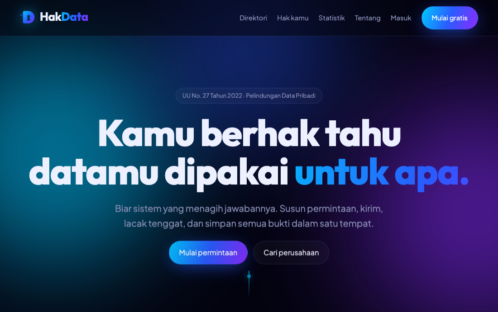

> **Bukan nasihat hukum.** Hak Data bukan pengadilan, regulator, atau firma hukum, dan tidak menjamin permintaan dikabulkan. Riset hukum disusun pengembang (dibantu AI) dan **belum ditinjau ahli hukum** ([legal-research.md](docs/legal-research.md)). Semua perusahaan di data contoh adalah **fiktif** (domain `.example`).

## Masalah

UU PDP memberi warga hak meminta akses, koreksi, penghapusan, dan penarikan persetujuan atas data pribadinya, dan untuk sebagian hak mewajibkan perusahaan menanggapi dalam **3 × 24 jam**. Dalam praktik, warga tidak tahu:

1. **ke mana** mengirim (kanal privasi tersebar dan tidak terverifikasi),
2. **apa** isi surat yang benar (pasal mana, data apa yang perlu disertakan),
3. **kapan** harus menagih (tidak ada yang mengingat tenggatnya), dan
4. **bagaimana** membuktikan bahwa permintaan pernah dikirim dan tidak dijawab.

Hak Data mengubahnya menjadi satu alur berurutan dengan status yang jelas, pengingat otomatis, dan jejak bukti yang tidak bisa diubah.

## Jalankan dalam 3 perintah

```bash
git clone <url-repo> hak-data && cd hak-data
docker compose up --build
open http://localhost:3000        # Linux: xdg-open; Windows: start
```

Masuk dengan `user@hakdata.demo` / `DemoPass!2026` (juga `admin@` dan `moderator@`). Email yang dikirim aplikasi tertangkap di **Mailpit** http://localhost:8025, antrean terlihat di **RabbitMQ** http://localhost:15673 (`hakdata`/`hakdata_dev`).

Compose menyalakan **mode demo**: perusahaan simulasi membalas tepat waktu, terlambat, atau diam, dan `DEADLINE_TIME_SCALE=8640` membuat **tenggat 72 jam menjadi 30 detik**. Skrip presentasi 3 menit: [docs/DEMO_SCRIPT.md](docs/DEMO_SCRIPT.md). Hanya butuh Docker; tidak perlu Node di mesin.

## Fitur

| Area | Yang berfungsi (semuanya diuji) |
|---|---|
| Direktori | Kanal privasi per perusahaan dengan status OFFICIAL / COMMUNITY_VERIFIED / UNVERIFIED dan sumbernya; usulan komunitas + moderasi |
| Surat | 6 jenis hak, template per hak dengan pasal yang diverifikasi, disclaimer, dapat disunting; surat tindak lanjut netral |
| Pengiriman | Email langsung ke kanal privasi dengan bukti kirim (Message-ID + SHA-256 isi), atau catat pengiriman manual |
| Tenggat | Aturan berversi; **hanya 4 hak dengan angka eksplisit di UU** yang punya hitung mundur 72 jam; versi aturan dibekukan per permintaan |
| Pengingat | "Menjelang tenggat", "tenggat lewat" (→ OVERDUE), dan tindak lanjut pribadi; in-app + email |
| Dossier | Kronologi append-only, bukti unggahan (validasi magic bytes), balasan perusahaan dengan selisih waktu otomatis, ekspor Markdown |
| Statistik | Rasio dan median waktu respons per perusahaan, hanya dari pengiriman terverifikasi dan **≥ 10 pengguna berbeda** (k-anonymity), dengan disclaimer metode |
| Admin | Terbitkan versi aturan hukum, kelola kanal, moderasi, audit log hanya-baca |
| Akun | Verifikasi email, ekspor data pribadi, hapus akun (data permintaan dihapus permanen) |

## Sekilas fitur

<table>
<tr>
<td width="50%" valign="top"><a href="docs/screens/02-direktori.jpg">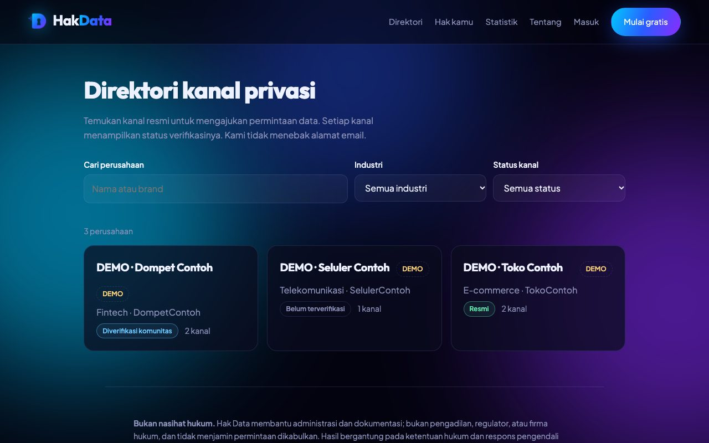</a><br><b>1. Direktori perusahaan</b><br><sub>Cari perusahaan dan lihat status verifikasi kanal privasinya (Resmi / Komunitas / Belum terverifikasi).</sub></td>
<td width="50%" valign="top"><a href="docs/screens/03-perusahaan.jpg">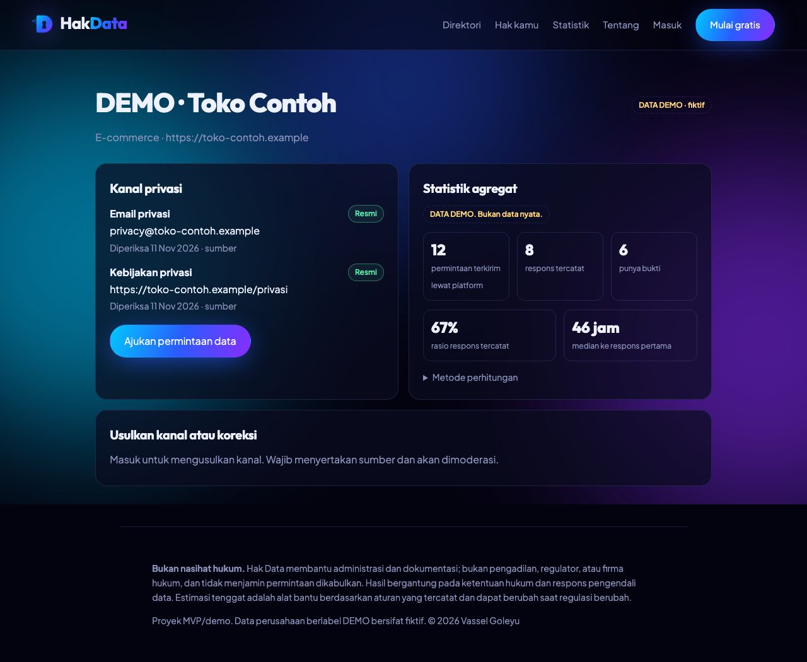</a><br><b>2. Kanal terverifikasi + statistik</b><br><sub>Kanal berikut sumbernya, dan statistik respons yang hanya tampil bila datanya cukup banyak pengguna.</sub></td>
</tr>
<tr>
<td width="50%" valign="top"><a href="docs/screens/04-surat.jpg">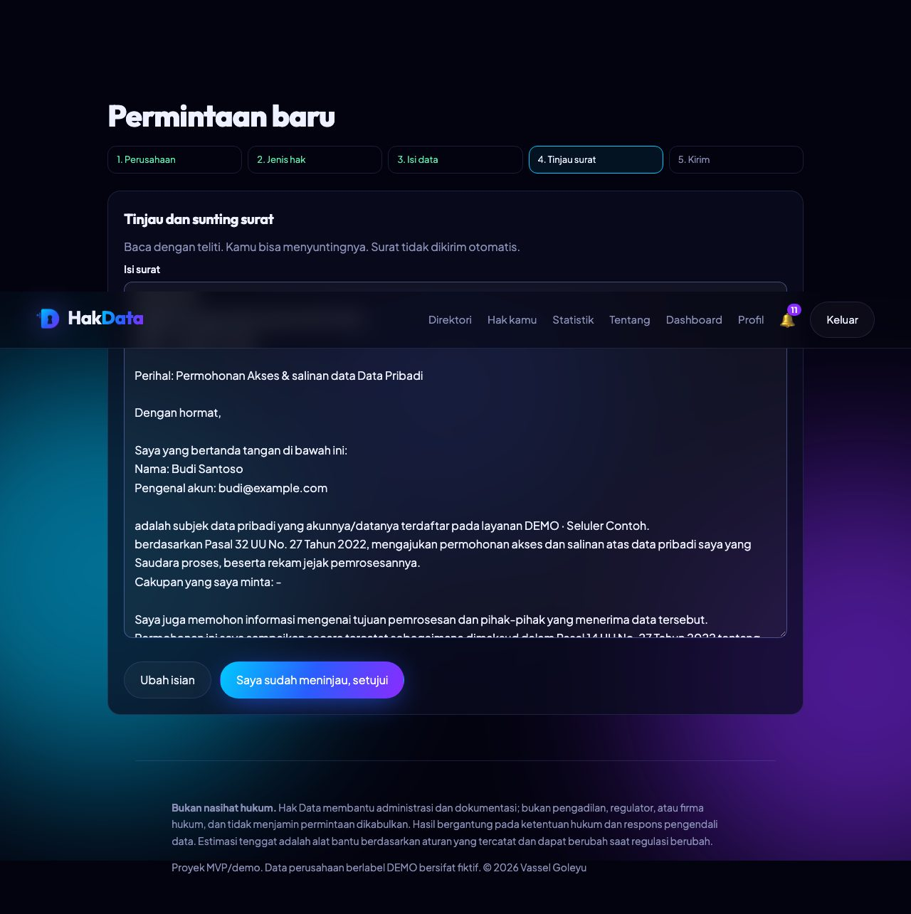</a><br><b>3. Surat per jenis hak</b><br><sub>Draf dari template dengan pasal terverifikasi dan disclaimer; dapat disunting sebelum disetujui.</sub></td>
<td width="50%" valign="top"><a href="docs/screens/05-tenggat.jpg">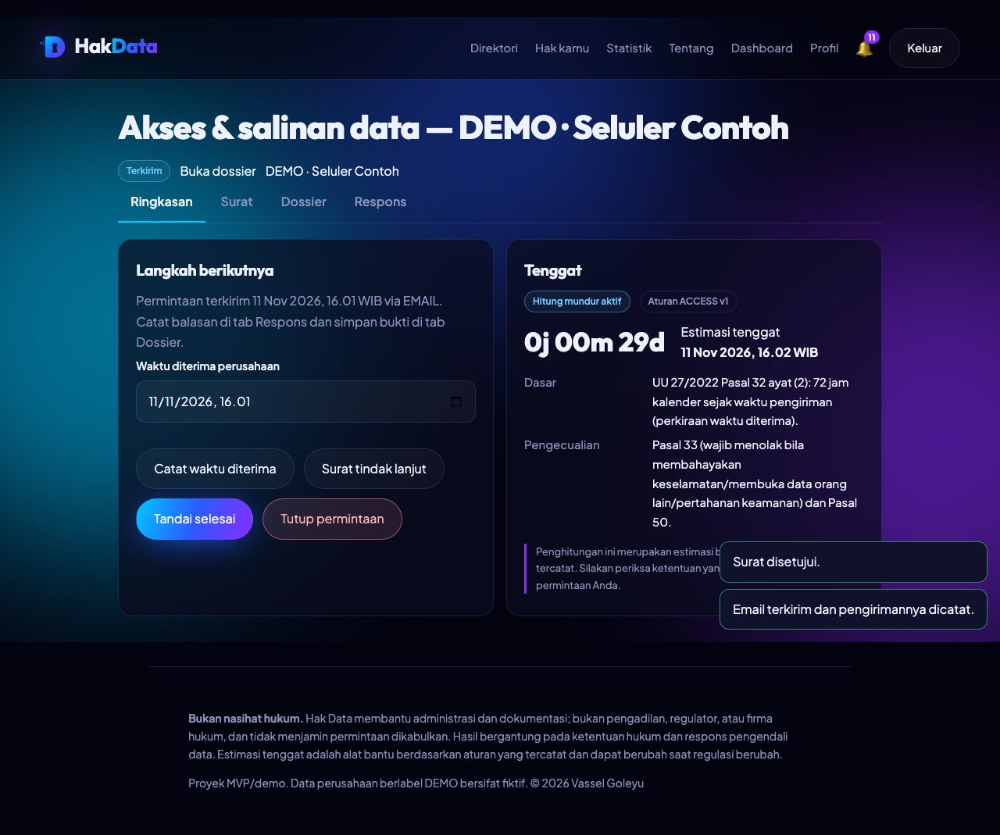</a><br><b>4. Tenggat dihitung otomatis</b><br><sub>Setelah terkirim: dasar hukum, pengecualian, dan estimasi tenggat dari aturan berversi.</sub></td>
</tr>
<tr>
<td width="50%" valign="top"><a href="docs/screens/06-overdue.jpg">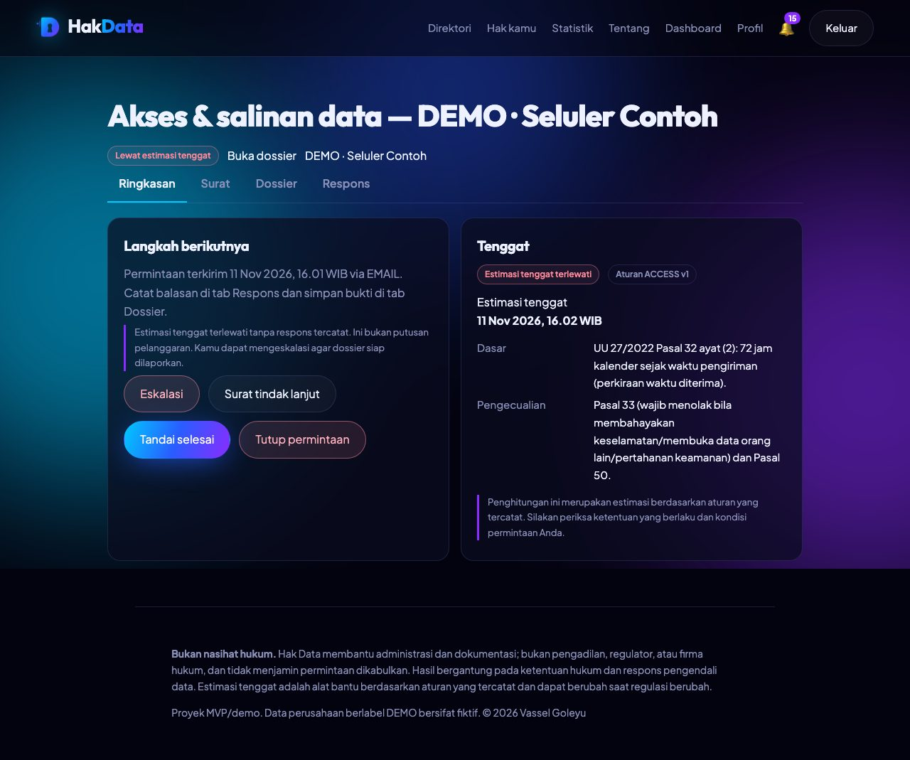</a><br><b>5. Lewat tenggat, keputusan di tangan pengguna</b><br><sub>Sistem menandai OVERDUE tepat waktu; eskalasi tetap pilihan pengguna, bukan putusan pelanggaran.</sub></td>
<td width="50%" valign="top"><a href="docs/screens/07-dossier.jpg">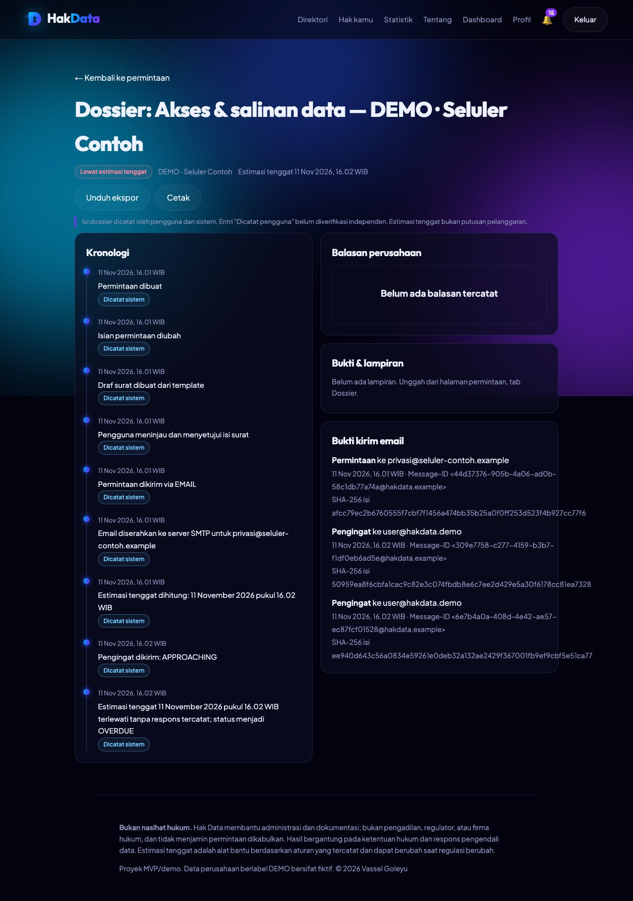</a><br><b>6. Dossier bukti</b><br><sub>Kronologi append-only, bukti kirim email (Message-ID + SHA-256), dan ekspor siap lapor.</sub></td>
</tr>
<tr>
<td width="50%" valign="top"><a href="docs/screens/08-notifikasi.jpg">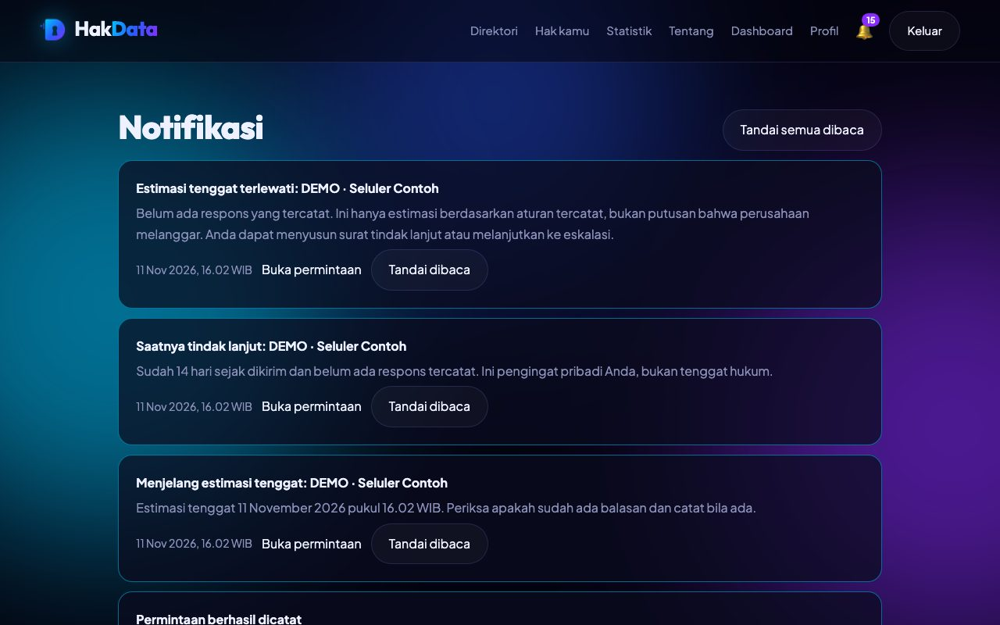</a><br><b>7. Pengingat</b><br><sub>Notifikasi menjelang dan setelah tenggat; email pengingat dikirim sekali dan dicatat.</sub></td>
<td width="50%" valign="top"><a href="docs/screens/09-statistik.jpg">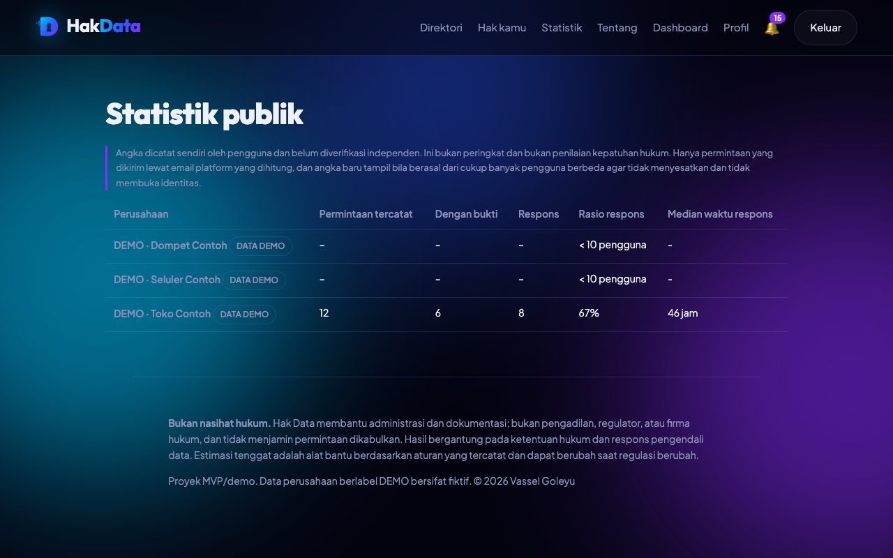</a><br><b>8. Statistik publik</b><br><sub>Rasio dan median waktu respons per perusahaan, berlabel DATA DEMO dan disertai metode.</sub></td>
</tr>
<tr>
<td width="50%" valign="top"><a href="docs/screens/10-admin-aturan.jpg">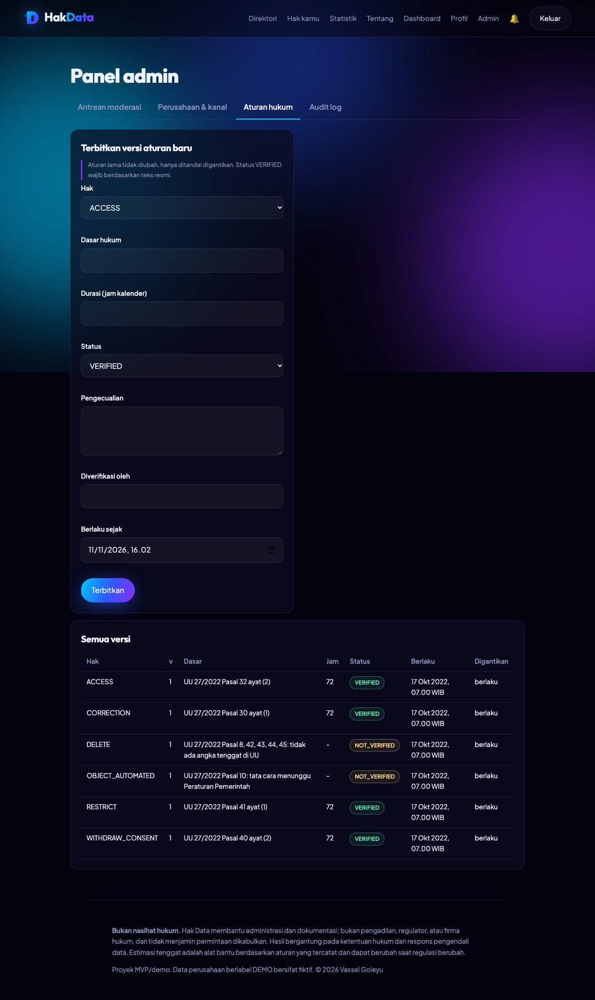</a><br><b>9. Aturan hukum berversi (admin)</b><br><sub>Aturan lama tidak diubah, hanya ditandai digantikan; hanya aturan VERIFIED yang menghasilkan hitung mundur.</sub></td>
<td width="50%" valign="top" align="center"><a href="docs/screens/11-mobile.jpg">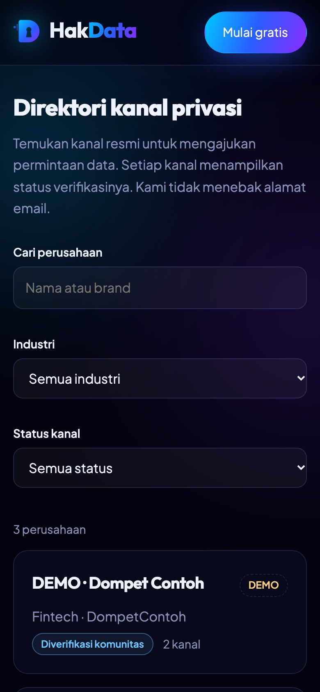</a><br><b>10. Responsif</b><br><sub>Seluruh alur dapat dipakai dari ponsel.</sub></td>
</tr>
</table>

> Semua tampilan di atas diambil otomatis dari stack `docker compose` yang berjalan, dengan data demo fiktif.

## Arsitektur

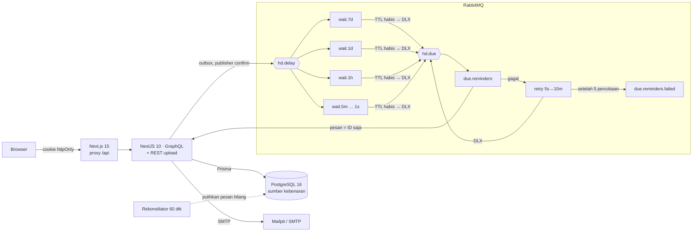

Alur satu permintaan:

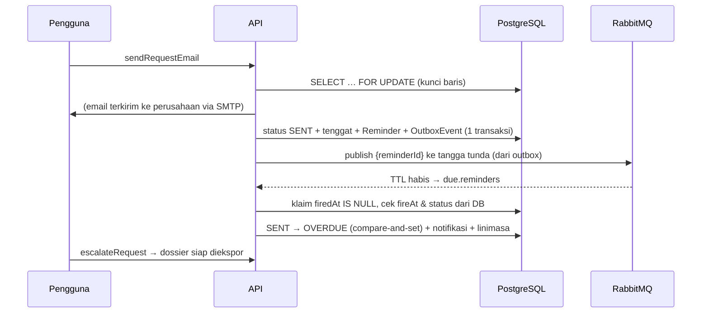

Detail lengkap: [docs/ARCHITECTURE.md](docs/ARCHITECTURE.md).

## Keputusan desain utama

**1. Pengingat lewat tangga antrean TTL + dead-letter, bukan cron dan bukan TTL per pesan.**
Tenggat berkisar dari 14 hari (tindak lanjut) sampai detik (mode demo). Pilihan yang ditolak:

| Alternatif | Mengapa tidak |
|---|---|
| Cron memindai tabel tiap menit | Presisi sebesar interval, beban naik seiring jumlah pengingat, dan satu cron mati = semua pengingat terlambat |
| TTL **per pesan** di satu antrean | RabbitMQ hanya mengedarkan pesan di **kepala** antrean: pesan 14 hari di depan menahan pesan 1 menit di belakangnya (*head-of-line blocking*) |
| Plugin `delayed-message-exchange` | Bukan bagian inti RabbitMQ, penyimpanan per node, tidak cocok untuk volume besar |

Yang dipakai: **7 antrean dengan TTL tetap** (7d, 1d, 1h, 5m, 1m, 10s, 1s). Karena TTL seragam per antrean, tidak ada head-of-line blocking. Sebuah pesan masuk ke tingkat terbesar yang ≤ sisa waktu, kedaluwarsa, jatuh lewat DLX ke `due.reminders`, lalu konsumen menghitung ulang sisa waktu **dari database** dan melompat ke tingkat berikutnya sampai habis. Ketepatan akhir ±1 detik; tenggat dua minggu butuh paling banyak ±60 lompatan, masing-masing hanya membaca satu baris DB.

**2. Database adalah sumber kebenaran; broker hanya pengantar.** Pesan berisi ID saja (tanpa waktu, status, atau PII). Reminder dan OutboxEvent ditulis dalam transaksi yang sama dengan perubahan status, jadi pesan tidak pernah hilang antara commit dan publish. Bila broker mati atau antrean dikuras, rekonsiliator per batch menandai OVERDUE langsung dari DB. Pesan ganda aman karena efek diklaim lewat `firedAt IS NULL`.

**3. Tenggat hanya dari aturan terverifikasi, berversi.** Aturan tanpa angka eksplisit di UU (mis. penghapusan) sengaja **tidak** punya hitung mundur, sehingga sistem tidak pernah menyebut "lewat tenggat" tanpa dasar hukum. Admin menerbitkan versi baru; permintaan lama tetap memakai versi yang berlaku saat dikirim.

**4. Konkurensi eksplisit.** Setiap perubahan status adalah compare-and-set (`UPDATE … WHERE status = yang dibaca`). Pengiriman email mengunci baris sebelum SMTP, jadi klik ganda tidak mengirim surat hukum dua kali.

**5. Skala waktu demo yang jujur.** `DEADLINE_TIME_SCALE` hanya dibaca satu modul dan diterapkan sekali saat `dueAt`/`fireAt` disimpan. Demo menjalankan mesin yang sama persis dengan produksi, hanya lebih cepat. Produksi menolak skala ≠ 1 kecuali `DEMO_MODE=true`.

## Kualitas dan keamanan

| Bukti | Jumlah |
|---|---|
| Unit test (Jest) | 182 |
| Integration test (Postgres + RabbitMQ + Mailpit sungguhan, DB uji terisolasi) | 82 |
| E2E (Playwright, termasuk terhadap stack `docker compose`) | 7 |
| Postman collection, setiap request beserta assertion | 33 request, 64 assertion |
| Mutation check: perbaikan dibalik → test terbukti gagal | 9/9 |

Model ancaman, mitigasi, dan **test yang membuktikan setiap mitigasi**, plus hasil audit dependensi dan secret: [docs/SECURITY.md](docs/SECURITY.md).

## Pengembangan

```bash
pnpm install                                   # Node >= 24.7 (.nvmrc; argon2id bawaan), pnpm 10 (corepack enable)
cp .env.example .env                           # ganti JWT_SECRET (>= 32 karakter)
docker compose up -d postgres rabbitmq mailpit # infrastruktur saja
pnpm db:migrate && pnpm db:seed
pnpm dev                                       # API :4000 + Web :3000 (proxy /api -> :4000)
```

| Perintah | Isi |
|---|---|
| `pnpm test` | Unit test: mesin tenggat, tangga tunda, state machine, surat, auth, mailer, env |
| `pnpm test:int` | Integration test; memakai DB `<nama>_test` yang direset dan di-seed otomatis (data dev tidak tersentuh) |
| `pnpm e2e` | Playwright (butuh API dan web berjalan; `WEB_URL` untuk port lain) |
| `pnpm check` | Format, lint, typecheck, unit test, build (sama dengan CI) |

**Postman:** impor [docs/postman/HakData.postman_collection.json](docs/postman/HakData.postman_collection.json) dan environment [HakData.local](docs/postman/HakData.local.postman_environment.json), lalu jalankan berurutan (Collection Runner). Alur: daftar → verifikasi email (token diambil otomatis dari Mailpit) → kirim permintaan → unggah bukti → dossier → uji negatif keamanan → admin. CLI: `newman run docs/postman/HakData.postman_collection.json -e docs/postman/HakData.local.postman_environment.json --working-dir .`

Variabel lingkungan: [.env.example](.env.example); API memvalidasinya saat boot dan berhenti dengan pesan jelas bila salah. Commit memakai Conventional Commits (commitlint + husky).

## Batasan

- **Hukum:** riset belum ditinjau ahli; hanya 4 hak dengan angka tenggat eksplisit yang dihitung; PP pelaksana belum diakomodasi; Lembaga PDP belum terbentuk sehingga tujuan eskalasi belum ditentukan.
- **Data:** isi balasan perusahaan dan bukti unggahan dicatat pengguna, belum diverifikasi independen; statistik bukan peringkat atau penilaian kepatuhan.
- **Teknis:** dependensi web perlu diperbarui (`next` 15.1.6 punya advisory kritis, lihat [SECURITY §4.1](docs/SECURITY.md#41-dependensi-dengan-advisory-osv-11-nov-2026)); refresh token belum dirotasi; lockout login in-memory (satu instance); tanpa antivirus upload dan enkripsi at-rest. Daftar lengkap: [SECURITY §6](docs/SECURITY.md#6-risiko-residu-diketahui-belum-ditutup) dan [known-limitations.md](docs/known-limitations.md).

## Roadmap

1. Perbarui dependensi (Next ≥ 15.5.28) dan jalankan ulang seluruh test.
2. Tinjauan ahli hukum; masukkan PP pelaksana UU PDP saat berlaku.
3. Tabel sesi per perangkat + rotasi refresh token; lockout dan rate limit di Redis.
4. Outbox email (menutup jendela "email terkirim tanpa tercatat").
5. CSP dengan nonce, antivirus berkas, enkripsi at-rest.
6. Kanal pengaduan resmi saat Lembaga PDP terbentuk; uji dengan pengguna nyata.

Rencana bertahap: [docs/ROADMAP.md](docs/ROADMAP.md).

## Dokumentasi

[Arsitektur](docs/ARCHITECTURE.md) · [Keamanan](docs/SECURITY.md) · [Skrip demo](docs/DEMO_SCRIPT.md) · [Spesifikasi](docs/SPEC.md) · [Desain skema](docs/SCHEMA_DESIGN.md) · [Sumber hukum](docs/LEGAL_SOURCES.md) · [Riset hukum](docs/legal-research.md) · [Keputusan](docs/DECISIONS.md) · [Analisis selisih](docs/GAP_ANALYSIS.md) · [API](docs/api-documentation.md) · [Testing](docs/testing-strategy.md) · [Deployment](docs/deployment-guide.md) · [Keterbatasan](docs/known-limitations.md)

## Author & License

Created by Vassel Goleyu. Copyright (c) 2026 Vassel Goleyu. All rights reserved.
