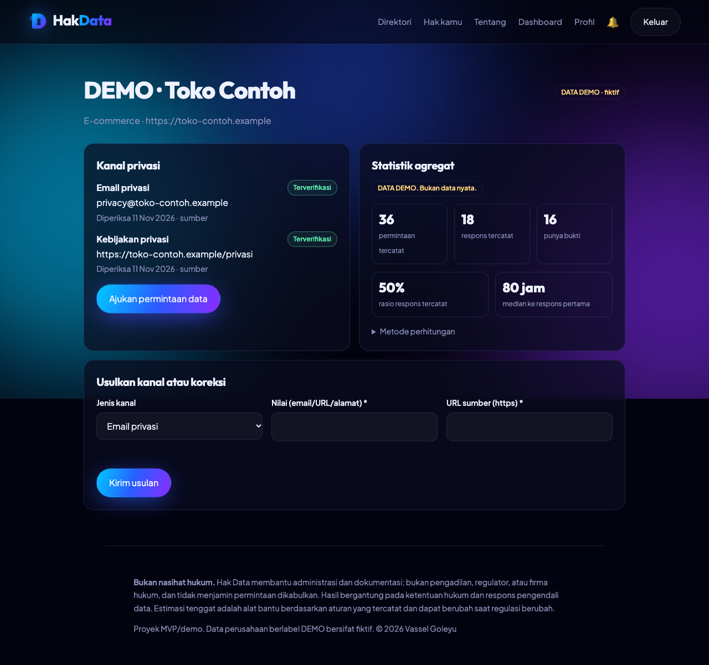
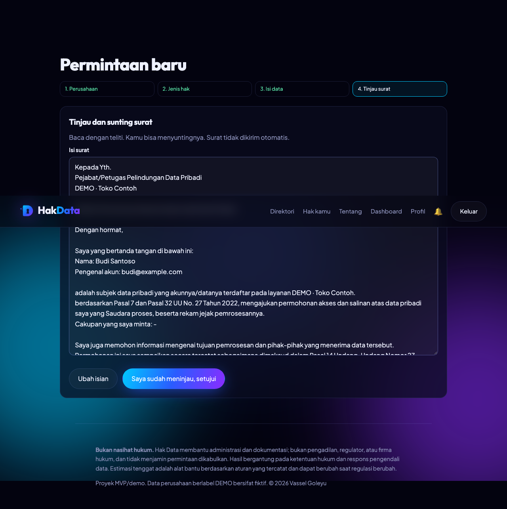
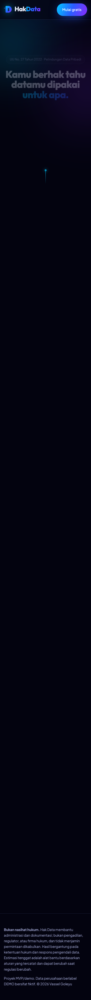

<!-- Copyright (c) 2026 Vassel Goleyu. All rights reserved. -->
# Hak Data

> *Kamu berhak tahu datamu dipakai untuk apa. Biar sistem yang menagih jawabannya.*

Platform MVP untuk membantu warga Indonesia menggunakan hak subjek data pribadi berdasarkan **UU No. 27 Tahun 2022 (UU PDP)**: memilih perusahaan, menyusun surat per jenis hak, mencatat pengiriman, menghitung estimasi tenggat **hanya dari aturan yang terverifikasi**, mengingatkan, dan menyimpan dossier bukti.

**Bukan nasihat hukum.** Hak Data bukan pengadilan, regulator, atau firma hukum, dan tidak menjamin permintaan dikabulkan. Riset hukum dibuat oleh pengembang (dibantu AI) dan **belum ditinjau ahli hukum**: lihat [docs/legal-research.md](docs/legal-research.md).





## Masalah dan solusi
Orang tidak tahu siapa yang harus dihubungi, hak apa yang bisa diminta, apa isi surat yang tepat, kapan harus menagih, dan tidak punya catatan terstruktur. Hak Data menjadikannya alur berurutan dengan status jelas (DRAFT → REVIEWED → SENT → RESPONDED → COMPLETED/CLOSED).

## Fitur yang sudah berfungsi (diuji)
- Direktori kanal privasi dengan status VERIFIED / COMMUNITY_REPORTED / UNVERIFIED / OUTDATED, pencarian, filter, usulan komunitas + moderasi
- 6 jenis hak, masing-masing punya template surat dan dasar pasal (dapat disunting)
- **Deadline engine berbasis aturan berversi**: hanya Akses, Perbaikan, Tarik Persetujuan, Tunda/Batasi yang punya hitung mundur 72 jam; Hapus dan Keberatan Otomatis **tanpa** hitung mundur (BELUM TERVERIFIKASI). Versi aturan disimpan per permintaan
- Dossier kronologis, unggah bukti (validasi magic bytes), respons perusahaan, surat tindak lanjut netral, ekspor dossier
- Pengingat via **outbox transaksional → RabbitMQ → consumer idempoten** (database tetap sumber kebenaran), notifikasi in-app
- Statistik agregat dengan ambang sampel minimum dan label DEMO
- Admin/moderator: moderasi, kelola perusahaan/kanal, terbitkan versi aturan hukum, audit log
- Ekspor data dan hapus akun

## Tech stack
Next.js 15 + React 19 + TypeScript · NestJS 10 + GraphQL (code-first, Apollo) · Prisma 5 + PostgreSQL 16 · RabbitMQ 3.13 · Playwright, Jest.

## Menjalankan
```bash
pnpm install                       # Node >= 22, pnpm 10 (corepack enable)
cp .env.example .env               # root repo; ganti JWT_SECRET (>= 32 karakter)
docker compose up -d               # Postgres :5433, RabbitMQ :5673 (UI :15673), Mailpit SMTP :1025 (UI :8025)
pnpm db:migrate && pnpm db:seed
pnpm dev                           # API :4000 + Web :3000 (proxy /api -> :4000)
curl localhost:4000/health         # {"status":"ok","checks":{"db":"up","rabbitmq":"up"}}; 503 bila salah satu mati
```
Variabel lingkungan: lihat [.env.example](.env.example); API memvalidasinya saat boot dan berhenti dengan pesan jelas bila salah. Struktur: `apps/api`, `apps/web`, `packages/shared`.

## Akun demo (hanya dev, dibuat oleh seed)
Kata sandi semua akun: `DemoPass!2026` — `admin@hakdata.demo` (ADMIN), `moderator@hakdata.demo` (MODERATOR), `user@hakdata.demo` (USER). **Jangan dipakai di produksi.**
Semua perusahaan di seed adalah **DEMO fiktif** (domain `.example`). Tidak ada data perusahaan nyata.

## Pengujian
```bash
pnpm test               # 15 unit test (deadline engine, state machine, surat, validasi env)
pnpm test:int           # 17 integration test: Postgres + RabbitMQ + GraphQL + upload + keamanan
pnpm e2e                # 5 Playwright E2E (butuh API & web berjalan)
pnpm check              # format, lint, typecheck, test, build (sama dengan CI, tanpa integration test)
```
Commit memakai Conventional Commits (commitlint) dan pre-commit lint-staged lewat husky.
Lihat [docs/testing-strategy.md](docs/testing-strategy.md) untuk hasil dan cakupan.

## Dokumentasi
[Overview](docs/project-overview.md) · [PRD](docs/product-requirements.md) · [Riset pasar](docs/market-research.md) · [Riset hukum](docs/legal-research.md) · [Arsitektur](docs/system-architecture.md) · [Database](docs/database-design.md) · [API](docs/api-documentation.md) · [Threat model](docs/threat-model.md) · [Rencana](docs/development-plan.md) · [Testing](docs/testing-strategy.md) · [Deployment](docs/deployment-guide.md) · [Keterbatasan](docs/known-limitations.md) · [Analisis selisih vs brief](docs/GAP_ANALYSIS.md) · [Keputusan](docs/DECISIONS.md)

## Keamanan (ringkas)
bcrypt (cost 12), JWT di cookie httpOnly SameSite=Lax, otorisasi di backend (guard global + pemeriksaan kepemilikan, 404 untuk milik orang lain), batas kedalaman/kompleksitas GraphQL, rate limiting, helmet, berkas bukti di luar direktori publik dengan nama acak. Detail dan celah yang tersisa: [threat model](docs/threat-model.md).

## Roadmap
Verifikasi ahli hukum; teks resmi PP 33/2026 (berlaku 16 Jan 2027); email notifikasi; Dockerfile aplikasi; antivirus berkas; kanal pengaduan resmi saat Lembaga PDP terbentuk; validasi pengguna nyata.

## Author & License
Created by Vassel Goleyu. Copyright (c) 2026 Vassel Goleyu. All rights reserved.
