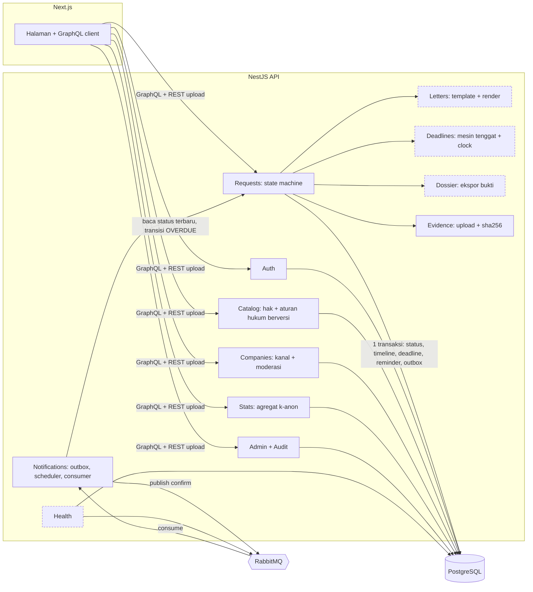
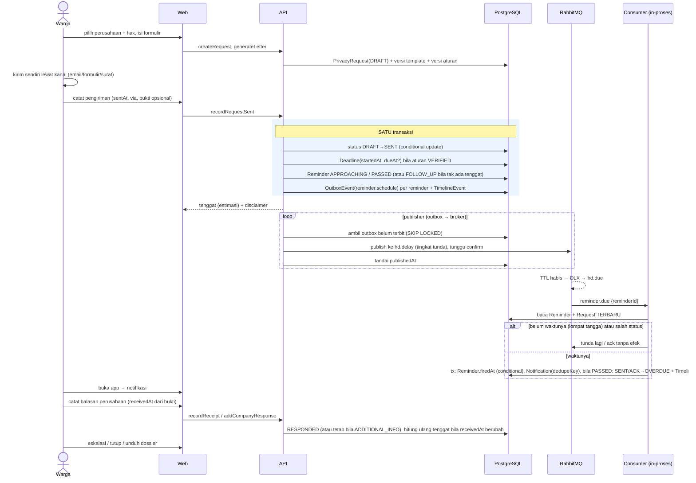
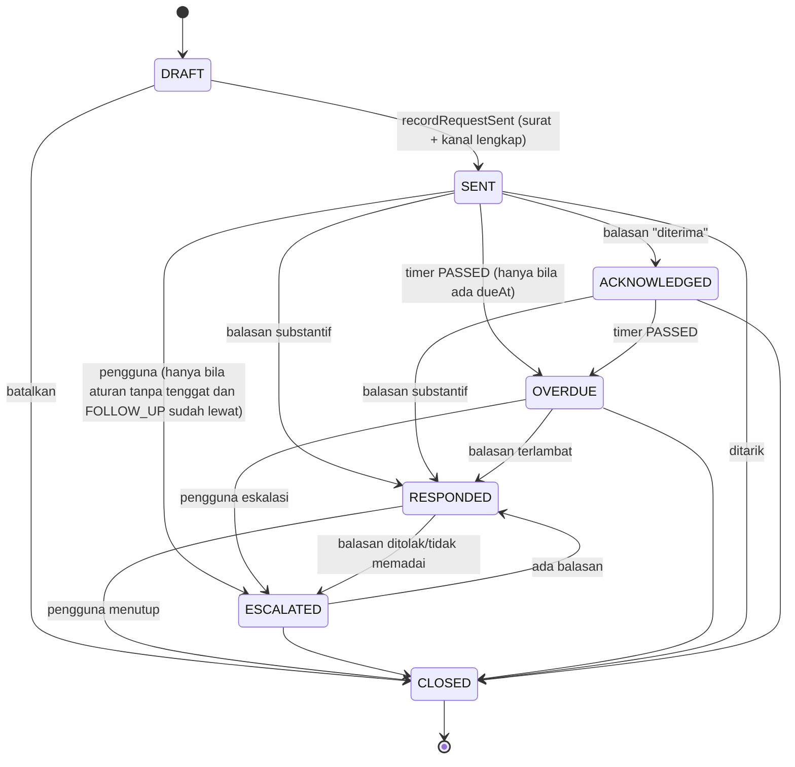
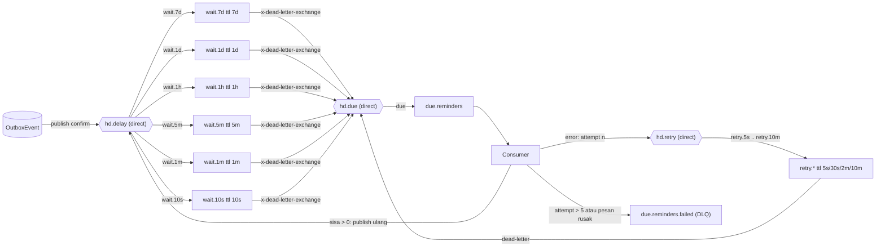

<!-- Copyright (c) 2026 Vassel Goleyu. All rights reserved. -->
# ARCHITECTURE: Hak Data (target)

Status: **Diusulkan (Fase 0).** Menjadi rujukan utama setelah disetujui; menggantikan [system-architecture.md](system-architecture.md) dan melengkapi [threat-model.md](threat-model.md). Dasar hukum: [LEGAL_SOURCES.md](LEGAL_SOURCES.md). Selisih dengan kode: [GAP_ANALYSIS.md](GAP_ANALYSIS.md) #1-6, 21.

Prinsip: **database = sumber kebenaran; RabbitMQ = pengantar waktu dan pekerjaan, bukan penyimpan kebenaran.** Setiap pesan bisa hilang, ganda, atau terlambat tanpa membuat data salah.

## 1. Modul

Modular monolith NestJS (satu proses, satu DB). Garis putus = pemisahan modul yang **baru** (kini tergabung di `requests`).

Aturan: logika murni (state, tenggat, surat) tinggal di `src/domain` tanpa dependensi DB/MQ; hanya `Deadlines.clock` yang membaca `DEADLINE_TIME_SCALE` (satu tempat).

## 2. Alur permintaan end-to-end

## 3. State machine

Target mengikuti brief (D-003, menunggu persetujuan): `REVIEWED` dan `COMPLETED` dihapus; `ACKNOWLEDGED`, `OVERDUE`, `ESCALATED` ditambah.

Aturan:
1. Semua transisi lewat satu fungsi `transition(from, to)` di `domain/request.state.ts`; DB memakai **conditional update** (`updateMany where id and status in (...)`) sehingga hanya satu penulis yang menang.
2. `ACKNOWLEDGED` **tidak** menghentikan jam. Hanya RESPONDED (balasan substantif) yang berhenti menghitung. Balasan ber-kategori `ADDITIONAL_INFO_REQUESTED` tetap `SENT`/`ACKNOWLEDGED` dan pengguna dapat memperbarui `receivedAt` (verifikasi, LEGAL_SOURCES L4); tenggat dihitung ulang dan dicatat di linimasa.
3. `OVERDUE` dan `ESCALATED` hanya bila ada `dueAt`, artinya aturan **VERIFIED**. Aturan belum terverifikasi tidak pernah OVERDUE; hanya pengingat FOLLOW_UP.
4. `ESCALATED` = "siap melapor, dossier dibekukan untuk ekspor". Tujuan lapor tidak ditentukan (Lembaga PDP belum ada).
5. Pemetaan data lama: `REVIEWED→DRAFT`, `COMPLETED→CLOSED` (+`closeReason=USER_COMPLETED`). Status lama `SENT` yang sudah lewat `dueAt` diubah ke `OVERDUE` oleh rekonsiliasi pertama.

## 4. Topologi RabbitMQ

### 4.1 Tangga tunda (delay ladder)

TTL per-queue tetap (bukan per-pesan) agar tidak ada head-of-line blocking. Satu pesan melompat ke tingkat terbesar yang ≤ sisa waktu, kedaluwarsa, lalu konsumen menghitung ulang sisa dan melompat lagi sampai habis. Ketepatan akhir dijamin pengecekan di DB, bukan TTL.

| Elemen | Jenis | Argumen / kunci | Catatan |
|---|---|---|---|
| `hd.delay` | exchange direct, durable | routing key `wait.<tingkat>` | Tingkat dipilih dari sisa waktu **setelah** skala |
| `wait.7d`, `1d`, `1h`, `5m`, `1m`, `10s` | queue durable | `x-message-ttl` = tingkat; `x-dead-letter-exchange=hd.due`; `x-dead-letter-routing-key=due` | Tanpa consumer; hanya penahan. Maks 49 hari per TTL RabbitMQ (cukup, follow-up 14 hari) |
| `hd.due` | exchange direct | key `due` | |
| `due.reminders` | queue durable | `x-dead-letter-exchange=hd.retry`; prefetch 10 | Satu-satunya queue yang dikonsumsi |
| `hd.retry` | exchange direct | key `retry.5s`, `retry.30s`, `retry.2m`, `retry.10m` | Backoff eksponensial menggantikan 30 dtk tetap |
| `retry.*` | queue durable | TTL sesuai nama; DLX `hd.due` | Konsumen menaikkan header `x-attempt` saat publish ulang |
| `due.reminders.failed` | queue durable | tanpa DLX | Alarm bila > 0. Pesan rusak (parse gagal) langsung ke sini |

Routing key domain untuk notifikasi masa depan (email stretch): exchange `hd.events` (topic) dengan `request.sent`, `request.overdue`, `request.escalated`, `reminder.approaching` → queue `notify.inapp` (dan `notify.email` bila stretch). MVP memakai jalur reminder di atas; `hd.events` hanya dibuat bila email dikerjakan.

### 4.2 Skala waktu (`DEADLINE_TIME_SCALE`)

`brokerMs = domainMs / SCALE`. Contoh `SCALE=1440`: 72 jam menjadi 3 menit, 24 jam menjadi 1 menit. Satu fungsi `scaled(ms)` di `Deadlines.clock`; `dueAt` di DB tetap waktu **nyata** pada mode produksi. Pada mode demo `dueAt` juga dihitung dengan skala supaya semua tampilan konsisten. Pengaman: bila `NODE_ENV=production` dan `SCALE != 1`, API menolak start kecuali `DEMO_MODE=true`; UI menampilkan banner "MODE DEMO: waktu dipercepat".

### 4.3 Pesan

`{ reminderId, kind, attempt }` saja (tanpa PII, tanpa status). Konsumen **selalu membaca keadaan terbaru dari DB**.

## 5. Idempotensi dan rekonsiliasi

| Lapisan | Mekanisme | Mencegah |
|---|---|---|
| Publish | Transactional outbox + publisher confirm; `publishedAt` diisi setelah confirm. Publish ulang aman | Kehilangan pesan antara commit DB dan broker |
| Konsumen | `Reminder.firedAt` lewat conditional update (`where firedAt is null`); `Notification.dedupeKey` unik `reminderId:kind:ruleVersion`; transisi lewat conditional update status | Pemrosesan ganda (pesan ganda, dua konsumen, redelivery) |
| Waktu | Konsumen mengabaikan TTL: bila `fireAt > now + toleransi`, publish ulang ke tingkat berikutnya; bila status bukan SENT/ACKNOWLEDGED, ack tanpa efek | Pesan datang terlalu cepat atau permintaan sudah dibalas |
| Ack | Ack **setelah** transaksi commit; error → retry berjenjang; > 5 → DLQ | Kehilangan pekerjaan saat crash |
| Rekonsiliasi | Cron 60 dtk, dikunci `pg_try_advisory_lock`: (1) outbox belum terbit > 30 dtk → publish; (2) reminder `fireAt <= now`, belum `firedAt`, `queuedAt` kosong atau > 2 menit → antre ulang; (3) `Deadline.dueAt <= now` dengan status SENT/ACKNOWLEDGED → panggil `applyOverdue(requestId)` **langsung** | Broker mati lama, queue ter-purge, restart, pesan tersangkut |

Satu fungsi domain (`applyReminder(id)`, `applyOverdue(requestId)`) dipakai bersama oleh konsumen dan cron, jadi jalur normal dan jalur pemulihan tidak bisa berbeda perilaku. Bukti wajib lewat test integrasi: (a) kirim pesan sama dua kali, (b) dua konsumen paralel, (c) broker dimatikan saat tenggat lewat lalu dinyalakan, (d) `purge` semua queue lalu rekonsiliasi memulihkan, (e) restart API di tengah tangga.

Log: JSON terstruktur (pino), field `requestId`, `reminderId`, `kind`, `attempt`; **redaksi** email, isi surat, nama berkas.

## 6. Model ancaman (STRIDE ringkas, tambahan)

Ancaman umum (login, IDOR, upload, SQLi, CSRF) tetap di [threat-model.md](threat-model.md). Yang baru karena desain di atas:

| STRIDE | Ancaman | Mitigasi | Test |
|---|---|---|---|
| **S**poofing | Pihak lain memasukkan pesan palsu ke `hd.delay` | Kredensial broker khusus per layanan, jaringan internal; pesan hanya ID dan konsumen memvalidasi terhadap DB | Pesan dengan ID acak = ack tanpa efek |
| **T**ampering | Mengubah payload agar mengubah tenggat | Payload tanpa waktu; waktu dari DB; transisi lewat conditional update | Payload dimanipulasi tidak mengubah `dueAt` |
| **R**epudiation | Menyangkal bahwa permintaan terkirim/OVERDUE | TimelineEvent append-only dengan `actor` dan sumber; AuditLog; sha256 bukti | Linimasa memuat event OVERDUE oleh `SYSTEM` |
| **I**nfo disclosure | PII di pesan, log, atau antrean gagal; IDOR di GraphQL baru (connection, dataloader) | Pesan hanya ID; redaksi log; semua resolver cek kepemilikan sebelum loader | Test negatif per resolver (GAP #14) |
| **D**oS | Banjir permintaan membuat reminder tak terbatas; pesan racun menyumbat queue | Maks reminder per permintaan (3) dan per pengguna; prefetch 10; retry berbatas; DLQ; rate limit | Pengguna A tidak bisa menghabiskan kuota B |
| **E**levation | Mengubah `DEADLINE_TIME_SCALE` atau aturan di produksi untuk memanipulasi tenggat | Pengaman start produksi; aturan hanya ADMIN, berversi, tercatat di AuditLog | Start produksi dengan SCALE≠1 gagal |

Risiko residu: enkripsi at-rest belum ada; tanpa antivirus upload; pencabutan token belum ada (lihat threat-model.md).
