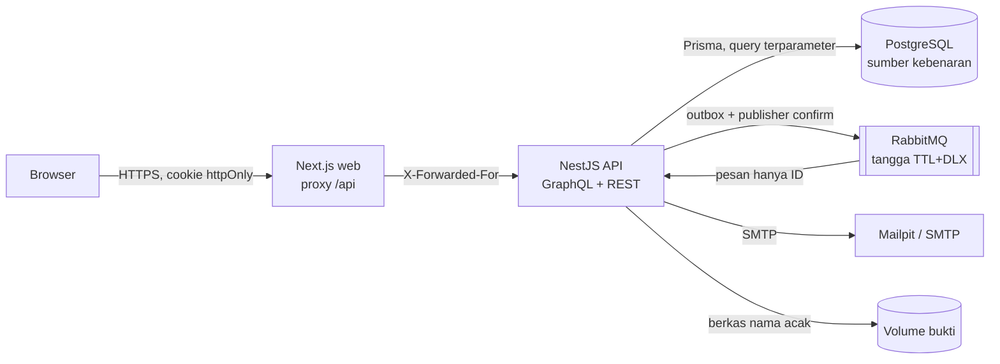

<!-- Copyright (c) 2026 Vassel Goleyu. All rights reserved. -->
# SECURITY: model ancaman, mitigasi, dan test yang membuktikannya

Dokumen ini menjawab tiga pertanyaan untuk setiap ancaman: **apa risikonya, apa yang mencegahnya (di kode mana), dan test mana yang gagal bila pencegahnya dicabut.** Kolom "Test" bukan klaim: sembilan perbaikan terpenting sudah diuji dengan *mutation check* (perbaikan dibalik sementara → test terkait terbukti GAGAL → perbaikan dipulihkan), lihat [§5](#5-bukti-bahwa-test-benar-benar-menjaga).

Ringkasan versi lama ada di [threat-model.md](threat-model.md); dokumen ini menggantikannya untuk Fase 8.

## 1. Aset dan aktor

| Aset | Mengapa berharga |
|---|---|
| Identitas pengguna (email, nama, isian surat, NIK yang mungkin diketik di catatan) | Data pribadi; produk ini justru tentang melindunginya |
| Linimasa dan bukti (berkas, hash, bukti kirim email) | Nilai pembuktian bila pengguna melapor; harus utuh dan tidak bisa disangkal |
| Statistik perusahaan | Publik; bila bisa dimanipulasi, merugikan perusahaan dan menyesatkan warga |
| Aturan tenggat hukum | Menentukan kapan sistem menyebut "lewat tenggat" |

| Aktor | Kemampuan yang diasumsikan |
|---|---|
| Pengunjung anonim | Memanggil semua endpoint publik, mengirim permintaan sebanyak-banyaknya |
| Pengguna terdaftar jahat | Punya sesi sah; mencoba membaca/mengubah data orang lain, meracuni statistik, mengirim berkas berbahaya |
| Situs pihak ketiga | Membuat browser korban mengirim permintaan (CSRF, clickjacking) |
| Penyerang jaringan/internal | Memasukkan pesan ke RabbitMQ, membaca log |

## 2. Batas kepercayaan

Setiap panah yang masuk ke API adalah batas kepercayaan: **semua validasi, otorisasi, dan transisi status terjadi di API**, bukan di web. Pesan RabbitMQ tidak dipercaya: isinya hanya ID, dan konsumen selalu membaca keadaan dari database.

## 3. Ancaman, mitigasi, dan bukti

Test unit ada di `apps/api/src/**/*.spec.ts`, integrasi di `apps/api/test/*.int.ts` (Postgres + RabbitMQ + Mailpit sungguhan), E2E di `apps/web/e2e/`.

### 3.1 Autentikasi dan sesi

| Ancaman | Mitigasi (kode) | Test |
|---|---|---|
| Kata sandi bocor dari DB | argon2id m=19 MiB, t=2 (OWASP); hash bcrypt lama di-rehash saat login (`common/password.ts`) | `auth.service.spec.ts` › "argon2id: hash unik per panggilan", "hash bcrypt lama diganti argon2" |
| Brute force | Kunci 5 gagal / 10 mnt per **(IP, email)**, peta dibatasi 10.000 entri; rate limit endpoint auth per IP (`auth/auth.module.ts`) | `auth.service.spec.ts` › "terkunci setelah 5 kegagalan" |
| Penyerang mengunci akun orang lain (DoS lockout) | Kunci per (IP, email), bukan per email saja | `auth.service.spec.ts` › "kunci per IP: penyerang dari IP lain tidak bisa mengunci pemilik akun" |
| Enumerasi akun | Login: pesan sama untuk email tak ada/sandi salah + hash palsu (waktu seragam). Register: email terdaftar mendapat respons sukses yang sama, pemilik diberi tahu via email | `auth.service.spec.ts` › "email tidak ada dan sandi salah memberi pesan sama", "email ganda: respons sama dengan sukses"; `auth.int.ts` › "daftar ulang dengan email yang sudah ada", "kirim ulang verifikasi tidak membocorkan" |
| Pencurian token lewat XSS | JWT hanya di cookie `httpOnly`, `SameSite=Lax`, `Secure` di produksi; tidak pernah di body/localStorage | `auth.int.ts` › "login sukses: cookie httpOnly + SameSite, tanpa token di body"; E2E wizard › tanpa PII di URL/storage |
| Sesi tidak bisa dicabut | `tokenVersion` di setiap token; logout/hapus akun menaikkannya → semua salinan cookie mati; guard memuat user dari DB tiap request | `auth.int.ts` › "refresh menerbitkan sesi baru; logout mencabut semua token, termasuk salinan cookie lama" |
| Token satu jenis dipakai sebagai jenis lain | Klaim `typ` (access/refresh/verify) diperiksa (`common/auth.ts`) | `auth.service.spec.ts` › "menolak token sampah, kedaluwarsa, jenis salah (access)" |
| Akun palsu massal | Login hanya setelah verifikasi email | `auth.int.ts` › "belum terverifikasi: login ditolak (FORBIDDEN)" |

### 3.2 Otorisasi

| Ancaman | Mitigasi (kode) | Test |
|---|---|---|
| IDOR: membaca/mengubah permintaan, dossier, bukti orang lain | Setiap query menyaring `userId` pemilik; milik orang lain = **404** (keberadaan ID tidak bocor) (`requests.service.ts` `own()`, `dossier.module.ts`, `EvidenceController`) | `requests.int.ts` › "IDOR: pengguna B tidak dapat menyentuh permintaan pengguna A", "ID yang tidak ada dan ID milik orang lain tidak dapat dibedakan"; `phase6.int.ts` › "dossier: kepemilikan"; `flow.int.ts` › "bukti: … hanya pemilik boleh mengunduh" |
| Lupa memasang guard | Guard global: semua endpoint butuh sesi kecuali yang ditandai `@Public()` | `requests.int.ts` › "tanpa login: UNAUTHENTICATED di semua operasi" |
| Eskalasi peran | `@Roles("ADMIN")` dievaluasi di guard dari peran **di DB** (bukan dari token) | `companies.int.ts` › "anonim, USER, dan MODERATOR ditolak"; `flow.int.ts` › "peran USER tidak bisa fungsi moderator/admin"; E2E › "moderator melihat antrean tetapi tidak aturan/audit" |
| Mass assignment (menyetel pemilik/status lewat argumen) | Hanya kolom yang terdaftar per jenis hak yang disimpan; status hanya lewat state machine | `requests.int.ts` › "createRequest tidak bisa menyetel pemilik atau status"; `flow.int.ts` › "mass assignment ditolak" |

### 3.3 Injeksi dan validasi input

| Ancaman | Mitigasi (kode) | Test |
|---|---|---|
| SQL injection | Prisma (query terparameter); raw SQL hanya tagged template | `flow.int.ts` › "… SQLi tidak berpengaruh" |
| Header injection email (Bcc tersembunyi) | Tujuan/subjek dengan CR/LF/`<>` ditolak sebelum menyambung SMTP (`common/mailer.ts`) | `mailer.spec.ts` › "header injection pada tujuan ditolak" |
| URL berbahaya (`javascript:`) di tautan publik | Kanal, sumber, dan website perusahaan wajib `https://` (`companies.module.ts`) | `flow.int.ts` › "spam/tanpa sumber ditolak" |
| Kueri GraphQL mahal (DoS) | Batas kedalaman 8 dan kompleksitas 300; introspeksi mati di produksi | `graphql-limits.spec.ts` › "kedalaman di batas lolos, satu lebih ditolak"; `flow.int.ts` › "query terlalu dalam ditolak" |
| Bocornya detail error internal | `formatError` hanya meneruskan error 4xx; selebihnya pesan generik | `flow.int.ts` › "error internal tidak membocorkan detail" |
| Konfigurasi salah di produksi | Env divalidasi saat boot; produksi menolak JWT contoh dan `DEADLINE_TIME_SCALE ≠ 1` tanpa `DEMO_MODE` (`env.ts`) | `env.spec.ts` › "produksi menolak JWT_SECRET contoh", "produksi dengan SCALE != 1 ditolak" |

### 3.4 Upload bukti

| Ancaman | Mitigasi (kode) | Test |
|---|---|---|
| Berkas berbahaya menyamar (HTML/SVG/EXE berekstensi .pdf) | Jenis dari **isi** (magic bytes), hanya PDF/PNG/JPG/WEBP; maks 10 MB, 1 berkas | `flow.int.ts` › "bukti: PNG asli diterima, file palsu ditolak" |
| Path traversal / menimpa berkas | Nama simpan UUID acak, `path.basename` saat baca/hapus, di luar direktori publik, mode 0600 (`common/files.ts`) | ditunjukkan oleh desain; nama asli hanya disimpan sebagai metadata tersanitasi |
| Konten diunggah lalu dijalankan di browser | Unduhan `Content-Disposition: attachment`, `X-Content-Type-Options: nosniff`, `Cache-Control: private, no-store` | `flow.int.ts` › "bukti: … hanya pemilik boleh mengunduh" |
| Satu unduhan mematikan seluruh API (berkas fisik hilang) | Stream punya handler error → 404 JSON (`requests.module.ts`) | `requests.int.ts` › "404 terkendali dan API tetap hidup" |

### 3.5 Integritas data dan mesin tenggat

| Ancaman | Mitigasi (kode) | Test |
|---|---|---|
| Klik ganda mengirim surat hukum dua kali | Baris dikunci `SELECT … FOR UPDATE` sebelum email dikirim (`requests.service.ts` `sendByEmail`) | `phase6.int.ts` › "dua sendRequestEmail paralel: tepat satu email ke perusahaan" |
| Aksi paralel saling menimpa status (mis. balasan membuka lagi permintaan CLOSED) | Compare-and-set: `updateMany where status = yang dibaca` (`RequestsService.move`) | `requests.int.ts` › "dua recordRequestSent paralel", "tutup vs respons paralel" |
| Status melompat (mis. COMPLETED → REVIEWED) | State machine murni + guard di setiap mutasi (`domain/request.state.ts`) | `request.state.spec.ts`; `requests.int.ts` › "transisi ilegal ditolak lewat API dan tidak mengubah apa pun" |
| Linimasa diubah/dihapus untuk menyangkal kejadian | Trigger Postgres append-only pada `TimelineEvent` | `requests.int.ts` › "UPDATE dan DELETE langsung ditolak" |
| "OVERDUE" palsu dari aturan yang belum terverifikasi | Hanya aturan VERIFIED dengan durasi angka yang menghasilkan `dueAt`; OVERDUE hanya dari `dueAt` itu | `deadlines.int.ts` › "aturan tanpa tenggat terverifikasi tidak pernah OVERDUE", "NEEDS_CONFIRMATION … juga tidak pernah OVERDUE" |
| Pesan RabbitMQ palsu/dimanipulasi | Pesan hanya `{reminderId, kind, attempt}`; waktu dan status dibaca dari DB; ID tak dikenal di-ack tanpa efek | `deadlines.int.ts` › "ID acak (pesan palsu) di-ack tanpa efek", "payload palsu diabaikan" |
| Pesan ganda / dua konsumen | Klaim `firedAt is null` dalam transaksi efek; `dedupeKey` unik | `deadlines.int.ts` › "pesan yang sama berkali-kali … menghasilkan satu OVERDUE, satu notifikasi" |
| Pesan hilang (broker mati, queue di-purge) | Outbox transaksional + rekonsiliator per batch | `deadlines.int.ts` › "queue di-purge: … dengan rekonsiliasi (paralel pun) SENT menjadi OVERDUE tepat sekali"; `flow.int.ts` › "broker tak tersedia tidak menghilangkan pesan" |
| Bukti kirim palsu (SMTP putus tapi tercatat terkirim) | Sukses hanya bila server menerima isi pesan | `mailer.spec.ts` › "server menutup koneksi setelah DATA tanpa menerima isi: reject" |
| Pengingat yang dijadwal ulang diam-diam tidak memberi tahu | `dedupeKey` memuat `fireAt` | `deadlines.int.ts` › "APPROACHING yang sudah terkirim lalu dijadwal ulang … menghasilkan notifikasi baru" |
| Manipulasi skala waktu demo di produksi | `DEADLINE_TIME_SCALE` hanya dibaca satu modul; produksi menolak ≠ 1 kecuali `DEMO_MODE=true` | `deadline.clock.spec.ts`; `env.spec.ts` |

### 3.6 Privasi

| Ancaman | Mitigasi (kode) | Test |
|---|---|---|
| Re-identifikasi pengguna dari statistik kecil | Angka hanya tampil bila berasal dari **≥ 10 pengguna berbeda**; di bawahnya semua hitungan `null` (`stats.module.ts`) | `requests.int.ts` › "satu akun dengan 12 permintaan tidak mencapai ambang; tidak ada angka mentah yang bocor" |
| Peracunan statistik oleh satu akun | Hanya pengiriman lewat email platform (waktu dan tujuan dicatat sistem) yang dihitung; ambang per pengguna | `requests.int.ts` › "10 pengguna berbeda: tampil; NO_RESPONSE bukan balasan; catatan manual … diabaikan" |
| Data tersisa setelah hapus akun | Permintaan + linimasa (berisi teks bebas) + bukti + bukti kirim dihapus permanen; berkas fisik dihapus; akun dianonimkan; sesi dicabut | `flow.int.ts` › "hapus akun menganonimkan data dan mencabut sesi" |
| PII di log | Log tanpa email/isi surat/token | `auth.int.ts` › "keluaran proses tidak memuat sandi, hash, JWT, secret, atau email pengguna uji" |
| PII di antrean pesan | Pesan hanya ID | desain `rabbit.service.ts` (skema `dueSchema`) |

### 3.7 Browser dan jaringan

| Ancaman | Mitigasi (kode) | Test |
|---|---|---|
| CSRF | Cookie `SameSite=Lax`; Apollo `csrfPrevention` (wajib header non-simple); upload REST tidak menerima cookie lintas situs | `flow.int.ts` › "cookie sesi httpOnly" |
| Clickjacking | `X-Frame-Options: DENY` + CSP `frame-ancestors 'none'` di web (`apps/web/next.config.mjs`) | E2E `flow.spec.ts` › "header keamanan web" |
| Sniffing tipe konten, header server | helmet di API, `nosniff` di web, tanpa `X-Powered-By` | `auth.int.ts` › "header keamanan API (helmet)"; E2E › "header keamanan web" |
| Semua pengguna berbagi satu kuota rate limit di belakang proxy | `trust proxy` (`TRUST_PROXY`): IP asli dari `X-Forwarded-For` hanya dari proxy tepercaya | `auth.int.ts` › "melewati batas → TOO_MANY_REQUESTS" (kuota per IP asli) |

## 4. Hasil pemeriksaan Fase 8

| Pemeriksaan | Cara | Hasil |
|---|---|---|
| Audit otorisasi semua resolver | Baca setiap `@Query`/`@Mutation`/controller; cocokkan dengan test negatif | Semua non-publik di balik guard global; publik hanya katalog, direktori, statistik, auth. Lihat §3.2 |
| Pemindaian secret | Pola regex (kunci privat, AWS/GitHub/Slack/Stripe/Google, JWT, `password=`) di working tree + **seluruh riwayat git** (`gitleaks` tidak tersedia offline) | Bersih. Satu-satunya `JWT_SECRET` adalah placeholder `.env.example`; `.env` tidak pernah di-commit |
| Audit dependensi | `pnpm audit` gagal (registry npm tidak terjangkau dari lingkungan pembuatan), diganti query **OSV.dev** untuk 1.146 paket di `pnpm-lock.yaml` | Ada temuan, lihat §4.1 |
| Kontrol test | Mutation check 9 perbaikan (§5) | 9/9 tertangkap |

### 4.1 Dependensi dengan advisory (OSV, 11 Nov 2026)

| Paket (runtime) | Terparah | Dampak bagi Hak Data | Perbaikan |
|---|---|---|---|
| `next@15.1.6` | **CRITICAL** (37 advisory: RCE Image Optimization, RCE React Flight, bypass middleware, SSRF rewrites) | Tinggi: web publik | **naikkan ke ≥ 15.5.28** |
| `multer@2.0.2` | HIGH (DoS) | Sedang: endpoint upload butuh login | ≥ 2.5.0 (lewat `@nestjs/platform-express`) |
| `body-parser@1.20.4`, `ws@8.18.0`, `qs@6.14.3` | HIGH/MODERATE (DoS) | Sedang | ≥ 1.20.9 / ≥ 8.21.0 / ≥ 6.16.1 |
| `zod@3.25.76` | HIGH (memori pada koleksi besar) | Rendah: hanya validasi env saat boot | ≥ 4.6.6 (mayor) atau terima |
| `postcss`, `sharp` | HIGH | Rendah: build-time / Image Optimization Next | ikut upgrade Next |
| `@nestjs/core`, `@apollo/server`, `file-type`, `uuid`, `lodash.omit` | MODERATE | Rendah–sedang | lihat OSV |

**Status: belum diterapkan.** Registry resmi tidak terjangkau saat pembuatan; menginstal *versi baru* dari mirror pihak ketiga berarti mempercayai hash dari mirror itu sendiri (berbeda dengan memasang lockfile yang ada, yang diverifikasi terhadap hash di `pnpm-lock.yaml`). Ini keputusan pemilik repo. Langkah: `pnpm up next@^15.5.28 @nestjs/platform-express@latest` lalu `pnpm check && pnpm test:int && pnpm e2e`.

## 5. Bukti bahwa test benar-benar menjaga

Test yang tidak pernah gagal tidak membuktikan apa pun. Untuk setiap perbaikan berikut, kodenya dibalik sementara, test terkait dijalankan, lalu kode dipulihkan; kontrol (tanpa mutasi) lulus.

| Perbaikan yang dibalik | Test yang gagal |
|---|---|
| Handler error stream unduhan dihapus | `requests.int.ts` › berkas fisik hilang |
| Compare-and-set status dihapus | `requests.int.ts` › recordRequestSent paralel |
| Kunci baris `sendByEmail` dihapus | `phase6.int.ts` › klik ganda |
| `dedupeKey` tanpa `fireAt` | `deadlines.int.ts` › dijadwal ulang |
| Ambang statistik per permintaan | `requests.int.ts` › satu akun dengan 12 permintaan |
| `trust proxy` dihapus | `auth.int.ts` › melewati batas |
| Mailer resolve saat koneksi putus | `mailer.spec.ts` › menutup koneksi |
| Lockout per email saja | `auth.service.spec.ts` › kunci per IP |
| Register membocorkan email | `auth.service.spec.ts` › email ganda |

## 6. Risiko residu (diketahui, belum ditutup)

| Risiko | Mengapa belum | Rencana |
|---|---|---|
| Dependensi rentan (§4.1) | Butuh registry tepercaya | Upgrade Next lebih dulu |
| Refresh token tidak dirotasi | Rotasi tanpa tabel sesi per perangkat me-logout perangkat lain | Tabel `Session` + deteksi pemakaian ulang |
| Statistik dapat diracuni oleh ≥ 10 akun palsu terverifikasi | Ambang per pengguna menaikkan biaya, tidak menghapusnya | Bobot usia akun / verifikasi lebih kuat |
| Email terkirim tanpa tercatat bila commit DB gagal tepat setelah SMTP menerima | Jendela satu commit; kunci baris mencegah duplikat | Outbox email |
| CSP tanpa `script-src` | Skrip inline Next butuh nonce | CSP nonce via middleware |
| Lockout login in-memory | Tidak lintas instance | Redis/DB |
| `TRUST_PROXY` default memercayai alamat privat/loopback | Di belakang proxy dengan alamat privat (mis. gateway Docker), klien yang sampai lewat alamat itu dapat memalsukan `X-Forwarded-For` | Set **jumlah hop** di deployment (compose memakai `1`); sesuaikan bila ada reverse proxy di depan web |
| Tanpa antivirus upload, tanpa enkripsi at-rest | Di luar cakupan MVP | ClamAV / volume terenkripsi |

## 7. Melaporkan kerentanan

Jangan buka issue publik. Hubungi pemilik repositori secara privat dengan langkah reproduksi; mohon beri waktu 30 hari sebelum publikasi.
